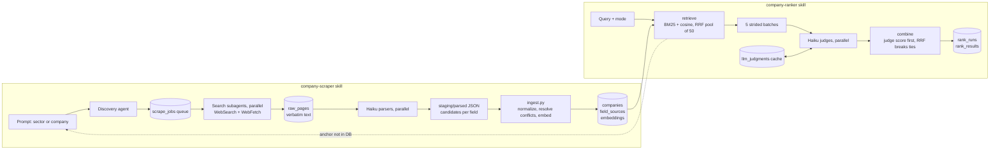

# Company search and acquisition ranking as Claude Code skills

By Justin Jonany.

This repo is two Claude Code skills over one SQLite database of company data. One skill collects company data from the web and structures it. The other ranks companies against a query: similar companies, free-text search, or acquisition targets. The database ships with the repo (101 companies, 495 stored web pages, 795 chosen field values with source URLs, 5 saved ranking runs), so you can replay everything without an API key.

## The two skills



**company-scraper.** You give it a sector or a company name. A discovery agent turns a sector into a list of companies and queues them. Parallel search subagents run WebSearch and WebFetch and store each page verbatim. They never summarize. Haiku parsers then read the stored pages and write candidate values per field, each with its source URL and a confidence. `ingest.py` normalizes the numbers, picks a winner per field, keeps every candidate, and builds the embeddings.

**company-ranker.** You give it a query. BM25 and cosine similarity each rank the companies, and reciprocal rank fusion (RRF) merges the two lists into a pool of 50. The pool is split into 5 strided batches, and 5 Haiku judges score their batches in parallel, 0 to 10, with a one-line reason. The final order is judge score first. RRF only breaks ties. There are three modes:

| Mode | Query | Judge question |
|---|---|---|
| similar | names an anchor company ("similar to Stripe") | How close is this company to the anchor? |
| search | free text ("AI tools for legal teams") | How well does it match the description? |
| acquisition | a buyer, a thesis, optional hard criteria | How good an add-on acquisition is it for the buyer? |

## Walkthrough

One example, start to finish. Every output below is copied from the shipped database and trimmed.

**1. Open the repo in Claude Code.** Both skills live in `.claude/skills/`, and the agent picks one from what you ask.

**2. Collect data.** Say "collect 20 payments companies" for a sector, or "add Checkout.com" for one company. The agent registers the companies, fans out search subagents, parses what they stored and ingests it. Checkout.com ended up with four stored pages:

```
id   source_type    retrieval       url                                         chars
---  -------------  --------------  ------------------------------------------  -----
283  data_provider  search_snippet  https://www.sacra.com/c/checkout-com        3206
298  data_provider  search_snippet  https://komo.ai/directory/checkout-com      2229
327  company_site   fetched_page    https://www.checkout.com                    1771
328  wikipedia      fetched_page    https://en.wikipedia.org/wiki/Checkout.com  2279
```

**3. Rank.** Say "companies similar to Stripe". Optional: "top 5" or "only score 6 and above". For acquisition, name the buyer, the thesis and any limits: "What could Datadog acquire to move into feature flagging and experimentation? Targets under 500 employees." If the company you name is not in the database, the ranker asks the scraper to collect it first. The result for the Stripe query, top 5 of 50 (the full table also has the retrieval ranks, employees and revenue):

```
| # | company      | judge | why                                                                       |
|---|--------------|-------|---------------------------------------------------------------------------|
| 1 | Adyen        | 9     | Direct competitor offering online and in-person payments, platforms, ...  |
| 2 | Worldpay     | 9     | Direct competitor: accepts online and in-store payments, payouts ...      |
| 3 | Checkout.com | 9     | Direct competitor: enterprise payment acceptance, fraud tools and ...     |
| 4 | Payabli      | 8     | Payments infrastructure for software platforms spanning acceptance, ...   |
| 5 | Square       | 8     | Strong match in payments and checkout for in-person and online sales, ... |
```

**4. Look again later.** `show` re-prints a saved run from the database. It computes nothing and calls no model:

```
.venv/bin/python ranker/rank.py show --run 4
```

**5. Ask where a number came from.** Say "Where does Checkout.com's employee count come from?" The agent runs this query:

```
sqlite3 -header -column data/companies.db "SELECT f.raw_value, f.confidence, f.chosen, p.source_type FROM field_sources f LEFT JOIN raw_pages p ON p.id = f.page_id WHERE f.company_id = (SELECT id FROM companies WHERE domain = 'checkout.com') AND f.field_name = 'employees' ORDER BY f.chosen DESC"
```

```
raw_value                     confidence  chosen  source_type
----------------------------  ----------  ------  -------------
About 2,000 people            high        1       wikipedia
about 1,870 (GetLatka, 2024)  medium      0       data_provider
about 2,000 (Komo)            medium      0       data_provider
```

The query lists every value the parser found for one field, with the type of page each came from. `chosen = 1` marks the value that was kept. Three sources gave an employee count. The Wikipedia value won because it has the highest confidence. The other two are third-party estimates, so they rank lower, but they stay in the table. Join to `raw_pages` on `page_id` to read the page itself.

### Replay without an API key

```
git clone https://github.com/Justin-Jonany/work-showcase.git
cd work-showcase
python3 -m venv .venv
.venv/bin/pip install -r requirements.txt
.venv/bin/python ranker/rank.py show --run 4
.venv/bin/python ranker/rank.py show --run 8
```

Run 4 is "companies similar to Stripe". Run 8 is the Datadog acquisition run. Live runs write to `data/companies.db`, so copy it first if you want to keep the replay data. The first embedding call downloads the `minishlab/potion-base-8M` model.

## Results

For "companies similar to Stripe", Adyen, Worldpay and Checkout.com come first, each scored 9. For Datadog as buyer with under 500 employees, the top three are Flagsmith, GrowthBook and LaunchDarkly, scored 10, 10 and 9 for matching the feature-flagging thesis. Honeycomb is first on cosine because it is an observability company like Datadog, but the judge gives it a 2 because it adds nothing new. The full tables, with reasons, employees and revenue, are in [examples/](examples/).

## Design choices

These are the choices I made on purpose, and the shortcuts I took to keep the demo simple.

### Changed on purpose

| Choice | Why | Cost |
|---|---|---|
| Judge score first, RRF only breaks ties | I used to feed the LLM score into RRF as one more signal next to BM25 and cosine. Models are now good enough that the judge can lead, so RRF only breaks ties. | Nothing overrides a wrong judge. |
| Claude Code skills, not a standalone app | People already work in Claude Code, so there is nothing new to adopt. The harness supplies parallel subagents, web tools and permissions. | Latency and cost per run depend on the agent. The ranking math and database writes stay plain Python scripts that run and test without an agent. |
| One judge call per batch, JSON straight from the judge | I used to need many tool calls and a second model to parse free text. Today's models do it in one call and write valid JSON. | A malformed file means re-running that batch. |
| Strided judge batches | Each judge sees the same mix of strong and weak candidates. | Needs the pool sorted first. |
| Per-field provenance, every candidate value kept | Any number traces to a URL, and conflicts stay visible. | More rows. |
| Judgment cache | Repeated queries cost no judge calls. | A re-scraped company keeps its old judgment. |

### Simplified for the demo

| Choice | Why | Cost | In production |
|---|---|---|---|
| Web search through Haiku subagents | Faster and easier to set up for a demo. | More expensive per company, and you only get the search tool's summaries, not the full pages. | A search or scraping service, or an in-house scraper. |
| Haiku subagents as judges | Easy to run in parallel inside the harness. | More expensive than calling the model directly. | Direct API calls. |

## Why use this instead of just asking an LLM?

**What do you get that a chat model doesn't give you?** The data. The scraper collects a lot up front, so whatever you ask about already exists. In a production version the data would come from licensed sources that a general model cannot reach.

**Is it faster?** On repeat questions, yes. The data and the judgments are cached, so the same question is not searched or judged twice.

**Is it easier to work with?** The workflow is already defined, so you ask in plain words and get the same steps each time. Results are reproducible, and every field has a source.

## How to productionize this

| Area | Here | In production |
|---|---|---|
| Data sources | Web search | Licensed data providers plus purpose-built scrapers, with entity resolution across sources |
| Amount of data | 101 companies | Millions |
| Embedder | Off the shelf | Fine-tuned on company text |
| Vector search | Brute-force cosine in SQLite | A vector database |
| Database | SQLite | Postgres |
| Pipeline state | Files in a temporary staging folder | Postgres |
| Orchestration and retries | The agent harness | A workflow engine such as Temporal |
| LLM calls | Haiku subagents | Direct API calls |
| Rubrics | One prompt per mode | Task-specific rubrics |
| Evals | None | A golden query set, judge-human agreement, and a gate on prompt changes |
| Hosting | A laptop | Kubernetes workers scaled on queue depth |

## More

```
.claude/skills/       company-scraper and company-ranker skill definitions
scraper/              CLIs: add_jobs, save_page, export_pages, list_jobs, normalize, ingest; agent prompts
ranker/               rank.py (retrieve, combine, show) and one judge prompt per mode
db.py, schema.sql     SQLite connection helpers and schema
embed.py              model2vec embeddings
data/companies.db     the database: 101 companies and 5 saved runs
docs/design.md        schema and ranking math
examples/             condensed logs of real runs
```

[docs/design.md](docs/design.md) has the schema and ranking math for anyone who wants the detail. [examples/](examples/) has the full logs.
